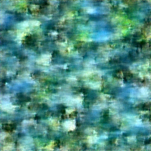
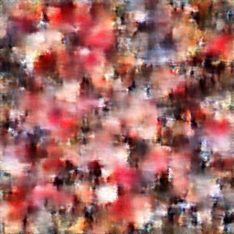
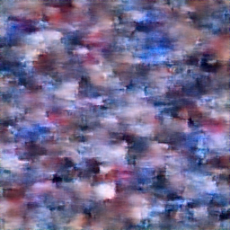
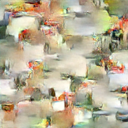
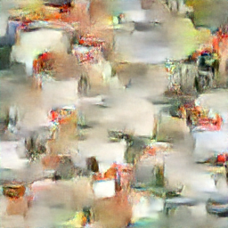

<p align="center">
  
</p>

# Camcookie AI Labs IMAGE

**Version:** 0.0.1-Experimental  
**Status:** Experimental

> This is the latest version of the model. To access its source code, simply open the folder corresponding to the latest model version.

A small, locally run model for text-conditioned image generation. This is an early prototype for experimentation, not a production image service; its quality has not been formally evaluated.

## At a glance

IMAGE uses a conditional diffusion process: it learns to predict noise added to training images, then generates an image by repeatedly denoising random noise using a text prompt. Its denoiser is a compact conditional U-Net with residual convolution blocks. A character-level text encoder and sinusoidal timestep embedding provide conditioning.

| Model detail | Configuration |
| --- | --- |
| Image size | 256 × 256 RGB |
| Denoiser | Conditional U-Net |
| U-Net channel widths | 32, 64, 128 |
| Prompt encoding | Lowercase character IDs |
| Maximum prompt length | 80 characters |
| Diffusion steps | 1,000 |
| Beta schedule | Linear, 0.0001 to 0.02 |

Prompts are zero-padded or truncated to 80 characters. Characters missing from the training vocabulary are encoded as zero, the same ID used for padding.

## Important: checkpoint and training data

> **The original dataset used to train the existing checkpoint was lost.** The car-focused dataset currently in `dataset/` is **not** the dataset used to train `checkpoints/latest.pt`. The original training data cannot be verified from the remaining files.

The generated examples below come from the existing checkpoint. If you train the model now, it starts a new model from scratch and uses the currently available images and captions.

## Train the model

Training expects:

- `dataset/captions.csv` with `filename` and `caption` columns
- Matching RGB images in `dataset/images/`

Images are resized to 256 × 256 and normalized to [-1, 1]. The current dataset is focused on cars, so training on it will not teach the model a broad range of subjects. The trainer does not read `dataset/attributions.csv`; keep attribution and license records with your data and follow the applicable licenses.

From this directory, install the dependencies and start training:

```powershell
python -m venv .venv
.\.venv\Scripts\Activate.ps1
python -m pip install -r requirements.txt
python train.py
```

Training uses AdamW with a learning rate of `0.0001`, for 100 epochs. The batch size is 4 on CUDA or 2 on CPU; CUDA is used when available. The objective is mean squared error between the actual noise and the model's predicted noise.

Each run initializes a new model; it does not resume training from the existing checkpoint. The trainer saves the model state and vocabulary to `checkpoints/latest.pt` after each epoch, replacing the previous checkpoint. Back it up first if you need to keep it. If you change the captions or rebuild the vocabulary, train a new model so the weights and vocabulary stay matched.

## Generate images

Run the generator from this directory. It loads `checkpoints/latest.pt` and uses CUDA when available:

```powershell
python generate.py --prompt "a red car on a country road"
```

Images and matching JSON metadata are saved under `generated/`. The metadata records the prompt, seed, resolution, timestep count, device, and filename.

```powershell
# Use a seed or request multiple images
python generate.py --prompt "a red car" --seed 123
python generate.py --prompt "a red car" --count 3
```

`--count` must be between 1 and 100. Sampling runs all 1,000 reverse-diffusion steps for each image, so generation may be slow, especially on CPU.

## Generated examples

Here are the five remaining images currently saved in `generated/`:

<table>
  <tr>
    <td align="center" width="50%">
      <br>
      <strong>Vintage muscle car on a snowy city street</strong><br>
      <em>“Create a photorealistic image of a vintage American muscle car parked on a snowy European city street at night. The car should have a classic 1970s design, chrome details, polished wheels, and dramatic reflections from the surrounding streetlights. Cinematic photography, realistic textures, highly detailed, professional automotive photography.”</em>
    </td>
    <td align="center" width="50%">
      <br>
      <strong>Classic muscle car with chrome wheels</strong><br>
      <em>“A photorealistic photograph of a classic American muscle car with chrome wheels, parked on a city street. Detailed automotive photography.”</em>
    </td>
  </tr>
  <tr>
    <td align="center" width="50%">
      <br>
      <strong>Red car, side view</strong><br>
      <em>“A photograph of a single red car, viewed from the side, parked on a road.”</em>
    </td>
    <td align="center" width="50%">
      <br>
      <strong>Simple prompt</strong><br>
      <em>“A car.”</em>
    </td>
  </tr>
  <tr>
    <td align="center" colspan="2">
      <br>
      <strong>Vintage red car</strong><br>
      <em>“A vintage red car.”</em>
    </td>
  </tr>
</table>

## Limitations

This version is suitable for local experiments with small text-conditioned image models. It may produce low-quality, incoherent, or prompt-inaccurate images. Results depend on the checkpoint and its unavailable original training data; there are no formal quality or safety guarantees.

## License

© 2026 Camcookie AI Labs. Licensed under the [MIT License](LICENSE).

Image data belongs to its respective owners; see [`dataset/attributions.csv`](dataset/attributions.csv) for attribution and license information.
